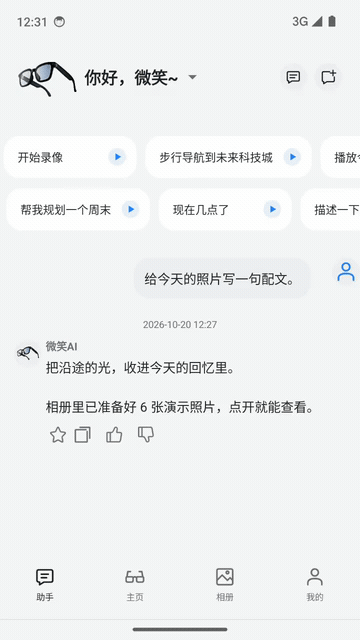

- 👋 Hi, I’m @mmf1ne
- 👀 I’m interested in GIS and AR
- 🌱 I’m currently learning swift and vibe coding
- 💞️ I’m looking to collaborate on QGis and AR/XR
- 📫 How to reach me [weixuchen.xyz](https://weixuchen.xyz)

## Hi微笑 AI 眼镜

面向微笑科技 AI 眼镜的 Android 伴侣应用，覆盖模拟设备连接、AI 助手、翻译、录音与会议纪要、时间轴相册及设备管理。

[查看项目与完整演示](https://github.com/mmf1ne/smiletech-ai-glasses)

  

<!---
mmf1ne/mmf1ne is a ✨ special ✨ repository because its `README.md` (this file) appears on your GitHub profile.
You can click the Preview link to take a look at your changes.
--->
